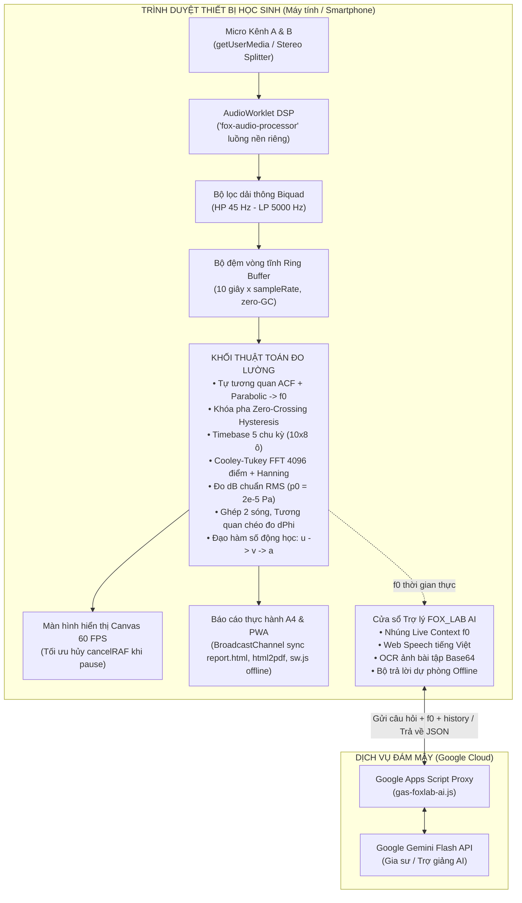

# FOX-Lab: Thiết kế phòng thí nghiệm Sóng âm di động trực quan hóa đại lượng vật lý và tự động hóa quy trình báo cáo thực hành trong môi trường lớp học

**Thời gian:** Oct 29, 2026 · @Võ Bình Minh  
**Lĩnh vực dự thi:** Vật lý và Thiên văn / Phần mềm hệ thống  
**Nhóm tác giả:** Ngô Hoàng Anh – Lớp 11A2, Phạm Thanh Bình – Lớp 11A7, Trường THPT Ngô Quyền  
**Giáo viên hướng dẫn:** Võ Bình Minh, đơn vị công tác: Trường THPT Ngô Quyền  
**Địa chỉ liên hệ:** email / số điện thoại  

---

### Tóm tắt
FOX-Lab là một ứng dụng web chạy trực tiếp trên trình duyệt của điện thoại, máy tính bảng hoặc máy tính, biến micro thành một dao động ký (oscilloscope) hai kênh để học sinh quan sát, đo đạc và phân tích sóng âm ngay trong lớp học, không cần thiết bị đo chuyên dụng.  
Ứng dụng thu tín hiệu âm thanh qua Web Audio API (sử dụng AudioWorklet đa luồng độc lập), lọc dải 45–5000 Hz, rồi tự động tìm tần số bằng thuật toán tự tương quan có nội suy parabol. Dựa trên tần số tìm được, hệ thống tự chọn thang thời gian để màn hình luôn hiển thị khoảng 5 chu kỳ và dùng điều kiện kích (trigger) qua điểm không có ngưỡng trễ (hysteresis) để dạng sóng đứng yên như trên dao động ký thật. Sau khi "khóa sóng", học sinh có thể phóng to thu nhỏ, đọc biên độ, chu kỳ, tần số trên lưới 10 × 8 ô, lưu ảnh đồ thị một chạm, vẽ đồ thị động học ($u-t, v-t, a-t$), hoặc mở chế độ phân tích FFT 4096 điểm với cửa sổ Hann để xem năm họa âm đầu tiên (H1–H5) của một nốt nhạc.  
Ngoài phần đo, dự án tích hợp trợ lý FOX-Lab AI qua Google Apps Script proxy. Trợ lý nhận tần số đo thời gian thực làm ngữ cảnh để giải thích hiện tượng, hướng dẫn xử lý số liệu và gợi ý cách viết báo cáo thực hành; khi mất kết nối, một bộ trả lời dự phòng cục bộ vẫn hoạt động. Mã QR trên giao diện giúp cả lớp mở cùng một địa chỉ web bằng điện thoại của mình.  
Điểm mới của dự án là gộp ba việc vốn tách rời – đo (dao động ký), phân tích (FFT, động học, mức dB) và tự động hóa quy trình báo cáo (phiếu A4 đồng bộ, trợ lý AI) – vào một công cụ miễn phí, nhẹ, chạy mượt mà ngoại tuyến (PWA Offline) trên thiết bị học sinh sẵn có. Báo cáo này trình bày cơ sở khoa học, thiết kế, các thuật toán cốt lõi, phương án thực nghiệm và hướng phát triển của sản phẩm.

**Từ khóa:** dao động ký, sóng âm, tần số, họa âm, FFT, Web Audio API, AudioWorklet, thí nghiệm ảo di động, trợ lý AI, Vật lí 11.

---

## Phần 1. Đặt vấn đề

### 1.1. Lý do chọn đề tài
Sóng âm là nội dung quen thuộc của chương Dao động và Sóng trong chương trình Vật lí 11 (chương trình giáo dục phổ thông 2018). Các đại lượng như biên độ, chu kỳ, tần số, độ cao, âm sắc đều có thể quan sát trực tiếp bằng dao động ký. Tuy vậy, trong thực tế dạy học, các khái niệm này thường chỉ được học qua hình vẽ trong sách hoặc mô phỏng có sẵn, nơi học sinh không tự tạo ra được dữ liệu của riêng mình.  
Dao động ký và máy phát tín hiệu chuyên dụng là thiết bị đắt tiền, cồng kềnh, thường chỉ có số lượng ít trong phòng thí nghiệm. Một lớp học 40–45 em khó có thể để mọi nhóm cùng thao tác. Trong khi đó, gần như mọi học sinh đều có điện thoại với micro chất lượng đủ tốt và trình duyệt hiện đại, nhưng các thiết bị này hiếm khi được khai thác như một dụng cụ đo trong giờ học.  
Từ quan sát đó, nhóm tác giả đặt câu hỏi: liệu có thể biến chính điện thoại của học sinh thành một phòng thí nghiệm sóng âm di động, vừa đo được, vừa phân tích được, vừa hỗ trợ viết báo cáo? FOX-Lab là câu trả lời của nhóm.

### 1.2. Thực trạng và hạn chế của các giải pháp hiện có
Nhóm đã xem xét ba nhóm giải pháp học sinh thường gặp:
1. **Dao động ký phần cứng:** Cho kết quả chính xác, nhưng thiếu về số lượng, giá thành đắt đỏ (hàng chục triệu đồng/máy), cần kỹ năng vận hành phức tạp và không thể mang về nhà được.
2. **Mô phỏng có sẵn (applet, video):** Dễ dùng, song dữ liệu là dữ liệu mẫu giả lập; học sinh không thể thử với âm thanh thật ngoài đời thực như tiếng sáo, âm thoa, đàn guitar hay giọng nói của chính mình.
3. **Ứng dụng đo âm trên điện thoại:** Nhiều ứng dụng đo mức ồn (dB) hoặc hiển thị phổ, nhưng ít ứng dụng được thiết kế theo cách dạy học: dạng sóng đứng yên như dao động ký, thang thời gian tính bằng ms, ghi chú theo ngôn ngữ của sách giáo khoa, và không gắn với việc viết báo cáo thực hành.

Nhìn chung còn thiếu một công cụ thỏa mãn đồng thời bốn yêu cầu: dùng được ngay trên thiết bị sẵn có, hiển thị theo đúng "ngôn ngữ" của dao động ký, có phân tích họa âm ở mức học sinh hiểu được, và đồng hành với học sinh khi xử lý số liệu.

### 1.3. Khó khăn trong báo cáo thực hành
Quy trình thực hành truyền thống gồm: lắp thiết bị, chỉnh máy, đọc số trên màn hình, ghi vào vở, chụp hoặc vẽ lại đồ thị, tính toán rồi viết báo cáo. Ở mỗi bước, học sinh thường mất nhiều thời gian vào thao tác kỹ thuật (chỉnh thang thời gian, chỉnh mức kích) thay vì suy nghĩ về hiện tượng vật lí. Giáo viên cũng khó theo dõi tiến độ của từng nhóm.

### 1.4. Tính cấp thiết
- Chương trình 2018 nhấn mạnh phát triển năng lực thực nghiệm và năng lực sử dụng công nghệ số trong học tập môn Vật lí.
- Điện thoại thông minh là thiết bị sẵn có, giúp giảm chi phí và mở rộng cơ hội thực hành ra ngoài phòng thí nghiệm.
- Việc tự động hóa các thao tác kỹ thuật lặp lại giúp học sinh dành thời gian cho phần quan trọng nhất của khoa học: quan sát, nhận xét, giải thích và rút ra kết luận.

---

## Phần 2. Mục tiêu, đối tượng và phương pháp nghiên cứu

### 2.1. Mục tiêu
- **Mục tiêu chung:** Thiết kế và hoàn thiện một phòng thí nghiệm sóng âm di động chạy trên trình duyệt, giúp học sinh trực quan hóa các đại lượng vật lí của sóng âm và giảm thao tác thủ công trong quy trình thực hành – báo cáo.
- **Mục tiêu cụ thể:**
  - Thu tín hiệu âm thanh từ micro của thiết bị và hiển thị dạng sóng theo thời gian thực như một dao động ký có lưới chia độ, trục thời gian (ms) và trục biên độ (V/ô).
  - Tự động xác định tần số cơ bản và tự điều chỉnh thang thời gian, kích sóng để dạng sóng đứng yên, dễ đọc chu kỳ.
  - Hỗ trợ đo cùng lúc hai nguồn âm (Kênh A và Kênh B) để so sánh biên độ, tần số, độ lệch pha chuẩn dấu.
  - Phân tích phổ bằng FFT để học sinh thấy được họa âm tạo nên âm sắc của nhạc cụ, giọng nói; tích hợp đo cường độ âm (dB) và phân tích đồ thị động học ($u-t, v-t, a-t$).
  - Tích hợp trợ lý hỏi đáp FOX-Lab AI và tiện ích xuất báo cáo thực hành A4 (PDF/Excel) đồng bộ thời gian thực.
  - Bảo đảm chạy mượt mà 60 FPS trên điện thoại, máy tính bảng và máy tính, hoạt động ngoại tuyến (PWA Offline) không cần cài đặt.

### 2.2. Nhiệm vụ nghiên cứu
1. Nghiên cứu cơ sở vật lí và xử lí tín hiệu cần thiết: lấy mẫu, tự tương quan, biến đổi Fourier rời rạc, cửa sổ Hann, tương quan chéo đo pha.
2. Thiết kế kiến trúc phần mềm AudioWorklet đa luồng và giao diện phù hợp với lớp học.
3. Cài đặt các thuật toán đo và hiển thị bằng JavaScript thuần, không phụ thuộc thư viện nặng bên ngoài.
4. Xây dựng trợ lý AI Gemini qua Apps Script và cơ chế dự phòng cục bộ khi mất mạng.
5. Thiết kế bài thực hành mẫu, phiếu báo cáo chuẩn A4 và phương án kiểm chứng độ chính xác.

### 2.3. Đối tượng và phạm vi
- **Đối tượng nghiên cứu:** Sóng âm trong dải tần 100–1500 Hz (dải tự động bám tần số) và mở rộng đến 5000 Hz đối với phổ họa âm bậc cao.
- **Đối tượng sử dụng:** Học sinh và giáo viên Vật lí cấp trung học phổ thông, ưu tiên lớp 11 (GDPT 2018).
- **Phạm vi:** Dùng làm công cụ minh họa, thực hành định tính và định lượng ở mức phổ thông. Biên độ điện áp được chuẩn hóa hiển thị và có chức năng đo mức decibel (dB) quy đổi theo áp suất âm chuẩn.

### 2.4. Phương pháp nghiên cứu
- **Nghiên cứu tài liệu:** Chương trình Vật lí phổ thông 2018, tài liệu về xử lí tín hiệu số (DSP) và đặc tả Web Audio API.
- **Thiết kế – lập trình theo vòng lặp (Agile/TDD):** Xây dựng nguyên mẫu, thử với âm thoa chuẩn, loa phát tần số, nhạc cụ; tinh chỉnh tham số (ngưỡng trễ hysteresis, bộ lọc 45–5000 Hz, làm mượt tần số).
- **Thực nghiệm đối chứng:** So sánh tần số FOX-Lab đo được với tần số chuẩn của nguồn phát; so sánh họa âm với phần mềm phân tích phổ chuyên nghiệp Audacity.
- **Khảo sát sư phạm:** Thu phiếu ý kiến học sinh và giáo viên về mức độ dễ dùng, mức độ giúp hiểu bài và thời gian hoàn thành báo cáo.

### 2.5. Công nghệ sử dụng
| Thành phần | Công nghệ | Vai trò |
| :--- | :--- | :--- |
| **Thu tín hiệu** | `getUserMedia`, `AudioWorkletNode` | Truy cập micro, xử lý đa luồng nền, nhận mẫu 128 mẫu/khối |
| **Bộ lọc số** | `BiquadFilterNode` (45 Hz & 5000 Hz) | Lọc tạp âm hạ âm, loại bỏ nhiễu cao tần, chống chồng phổ |
| **Xử lí thuật toán** | JavaScript thuần (ES6+) | Tự tương quan (ACF), trigger hysteresis, FFT 4096 điểm, tương quan chéo |
| **Hiển thị đồ thị** | HTML5 Canvas 2D (`requestAnimationFrame`) | Vẽ lưới dao động ký, nhãn thời gian, dạng sóng 2 kênh, phổ FFT |
| **Giao diện UI** | HTML5, CSS3 Responsive | Bố cục co giãn tương thích điện thoại, máy tính bảng, máy tính |
| **Báo cáo A4** | `BroadcastChannel`, `html2pdf.js` | Đồng bộ thời gian thực sang report.html, xuất PDF A4, Excel CSV |
| **Trợ lý AI** | Google Apps Script, Gemini Flash API | Cầu nối đám mây bảo mật, xử lý lịch sử đa lượt, ngữ cảnh $f_0$ thời gian thực |
| **Triển khai PWA** | Service Worker (`sw.js`), Web Manifest | Lưu đệm tài nguyên tĩnh, hoạt động ngoại tuyến 100% không cần Internet |

---

## Phần 3. Cơ sở lí thuyết

### 3.1. Sóng âm và các đại lượng đặc trưng
Sóng âm là sóng cơ dọc truyền trong môi trường vật chất. Micro chuyển sự biến thiên áp suất không khí thành tín hiệu điện, sau đó được số hóa thành dãy giá trị biên độ theo thời gian. Với âm đơn sắc, tín hiệu có dạng hình sin:
$$u(t) = A \sin(2\pi f t + \varphi)$$
Trong đó $A$ là biên độ, $f$ là tần số, $\varphi$ là pha ban đầu. Chu kỳ $T$ và tần số $f$ liên hệ với nhau và với bước sóng $\lambda$, tốc độ truyền sóng $v$: $T = \frac{1}{f}$, $v = \lambda f$.  
Ba đặc trưng sinh lí của âm gắn với ba đặc trưng vật lí: độ cao gắn với tần số $f$; độ to gắn với biên độ (hay mức cường độ âm $L$); âm sắc gắn với dạng đồ thị dao động, tức là thành phần các họa âm.

### 3.2. Họa âm và âm sắc
Nhạc cụ và giọng nói không phát ra một sóng sin thuần túy mà là tổng của sóng cơ bản tần số $f_0$ và các họa âm có tần số là bội số nguyên của $f_0$:
$$u(t) = \sum_{k=1}^{N} A_k \sin(2\pi k f_0 t + \varphi_k)$$
Cùng một nốt La 440 Hz nhưng sáo, đàn guitar và giọng người có biên độ $A_1, A_2, A_3\dots$ khác nhau nên dạng sóng khác nhau, tai người nhận ra là các âm sắc khác nhau. Đây là lí do FOX-Lab hiển thị năm họa âm đầu ($H_1$ đến $H_5$) ở chế độ phân tích FFT.

### 3.3. Lấy mẫu và điều kiện Nyquist
Trình duyệt số hóa âm thanh với tần số lấy mẫu $f_s$ (thường là 44.100 Hz hoặc 48.000 Hz). Theo định lí lấy mẫu Nyquist–Shannon, tín hiệu được khôi phục nguyên vẹn nếu tần số cao nhất không vượt quá $f_s / 2$. Với $f_s = 48.000\text{ Hz}$, giới hạn Nyquist là 24.000 Hz, cao hơn nhiều so với dải lọc 45–5000 Hz của FOX-Lab, do đó hiện tượng chồng phổ (aliasing) hoàn toàn được triệt tiêu.

### 3.4. Xác định tần số bằng hàm tự tương quan
Với một dãy mẫu $x[n]$, hàm tự tương quan tại độ trễ $\tau$ được định nghĩa:
$$R(\tau) = \sum_{n=0}^{N-1-\tau} x[n] \cdot x[n + \tau]$$
Với tín hiệu tuần hoàn chu kỳ $T_0$, $R(\tau)$ đạt cực đại tại $\tau = 0$ và lặp lại cực đại tại $\tau \approx T_0 \cdot f_s$. Vị trí cực đại thứ hai cho biết chu kỳ, suy ra $f = f_s / \tau^*$.  
Để giảm sai số rời rạc, FOX-Lab nội suy parabol qua 3 điểm $R(\tau^* - 1), R(\tau^*), R(\tau^* + 1)$:
$$\tau^*_{\text{chính xác}} = \tau^* - \frac{b}{2a}, \quad \text{với } a = \frac{R_{-1} + R_{+1} - 2R_0}{2}, \; b = \frac{R_{+1} - R_{-1}}{2}$$

### 3.5. Biến đổi Fourier rời rạc và FFT
Để bóc tách phổ tần số, biến đổi Fourier rời rạc được áp dụng:
$$X[m] = \sum_{n=0}^{N-1} x[n] \cdot e^{-j \frac{2\pi m n}{N}}, \quad m = 0, 1, \dots, N-1$$
Thuật toán Cooley-Tukey FFT cơ số 2 giảm khối lượng tính toán từ $N^2$ xuống $N \log_2(N)$. Với $N = 4096\text{ điểm}$ và $f_s = 48.000\text{ Hz}$, độ phân giải tần số đạt $\Delta f \approx 10.7\text{ Hz}$, cho phép nhận diện rõ ràng từng đỉnh họa âm.

### 3.6. Rò rỉ phổ và cửa sổ Hann
Do tín hiệu thực tế bị cắt ngắn hữu hạn trong cửa sổ lấy mẫu, hiện tượng rò rỉ phổ xảy ra nếu hai đầu mút không khớp pha. FOX-Lab nhân đoạn tín hiệu với hàm cửa sổ Hanning trước khi biến đổi FFT:
$$w[n] = 0.5 \cdot \left[1 - \cos\left(\frac{2\pi n}{N - 1}\right)\right]$$

### 3.7. Điều kiện kích (trigger) của dao động ký
Dao động ký thật cần điểm kích (trigger) để dạng sóng không bị trôi dạt ngang màn hình. FOX-Lab mô phỏng cơ chế này bằng thuật toán tìm điểm cắt không (zero-crossing) theo chiều đi lên kết hợp ngưỡng lọc trễ (hysteresis = 2% peak amplitude), giúp dạng sóng đứng yên vững vàng trên màn hình.

---

## Phần 4. Thiết kế tổng thể hệ thống

### 4.1. Nguyên lí thiết kế
- **Dùng ngay, không cài đặt:** Chỉ cần mở một đường dẫn web hoặc quét mã QR; toàn bộ xử lí tín hiệu chạy tại trình duyệt cục bộ, bảo mật tuyệt đối.
- **Trải nghiệm như dao động ký thật:** Lưới 10 × 8 ô, hai trục đi qua tâm, nhãn thời gian (ms) và biên độ, dạng sóng đứng yên nhờ trigger.
- **Tự động ở chỗ máy làm tốt hơn người:** Tự bám tần số, tự chọn thang thời gian, tự dừng và khóa sóng.
- **Học sinh vẫn là người quan sát và tư duy:** Thu phóng, đọc số, so sánh hai kênh và rút ra nhận xét.
- **Bền bỉ với môi trường lớp học thật:** Tương thích mọi thiết bị, mạng yếu có thể chạy ngoại tuyến PWA, xử lý lọc nhiễu phòng học.

### 4.2. Kiến trúc phần mềm và Sơ đồ khối hệ thống
Hệ thống gồm 6 khối xử lý tại chỗ trên thiết bị người dùng (Client Browser), 2 khối giao diện tương tác và 1 dịch vụ AI đám mây dự phòng.

*(Hình ảnh sơ đồ khối chất lượng cao 300 DPI đã được biên soạn và nhúng trực tiếp trong tệp Word chính thức: [FOX_LAB_BAO_CAO_KHKT_CHINH_THUC.docx](file:///c:/Users/THUY/.gemini/antigravity/scratch/Fox_labKHKT/FOX_LAB_BAO_CAO_KHKT_CHINH_THUC.docx)).*

### 4.3. Giao diện người dùng
Giao diện chia thành thanh điều khiển ở trên và vùng đồ thị chiếm phần lớn màn hình bên dưới. Bảng thông tin hoạt động như một máy trạng thái (State Machine):

| Trạng thái | Thông báo hướng dẫn trên màn hình | Nút khả dụng |
| :--- | :--- | :--- |
| **Chưa kết nối micro** | Nhấn vào Kênh A hoặc Kênh B để thu sóng âm | Kênh A, Kênh B |
| **Đã kết nối, chưa đo** | Bấm Đo / Dừng để khảo sát | Đo / Dừng, Làm mới, Chụp ảnh |
| **Đang đo** | Đang quét tín hiệu: Kênh A & Kênh B (chữ xanh) | Đo / Dừng (nút đỏ "Đang đo...") |
| **Đã khóa sóng** | Đã khóa sóng. Bấm Phân tích đồ thị để chọn chức năng | Phân tích đồ thị, FFT, Chụp ảnh, Báo cáo A4 |

### 4.4. Chế độ một và hai nguồn âm
- **Chế độ 1 nguồn âm:** Dành cho khảo sát tần số cơ bản, đo 2 điểm vi phân, vẽ đồ thị động học $u-t, v-t, a-t$ và phân tích phổ FFT.
- **Chế độ 2 nguồn âm:** Hai luồng micro hoạt động đồng thời, vẽ chồng 2 sóng (Overlay) hoặc tổng hợp (Sum mode A+B). Đo tương quan chéo xác định độ lệch pha chuẩn dấu $\Delta\varphi$ và phát hiện sóng phách tự động khi $|f_A - f_B| > 3\text{ Hz}$.

### 4.5. Chế độ đo
- **Khảo sát tần số (tự dừng):** Hệ thống quét tín hiệu và tự dừng sau 2 giây khi sóng đã ổn định, khóa dạng sóng trên màn hình để học sinh đọc số, phóng to thu nhỏ và mở phân tích FFT.
- **Khảo sát liên tục:** Đồ thị cập nhật liên tục cho đến khi học sinh bấm Dừng, phù hợp theo dõi giọng nói biến thiên hoặc hiện tượng sóng phách ngân nga.

### 4.6. Khả năng tương thích và triển khai PWA
Ứng dụng tương thích hoàn hảo các kích thước màn hình từ điện thoại xoay dọc, xoay ngang đến máy tính bảng và màn hình máy chiếu. Tích hợp Service Worker v6.4.0 và Web Manifest cho phép cài đặt ứng dụng lên màn hình chính và khởi chạy ngoại tuyến (Offline PWA) không cần mạng.

---

## Phần 5. Các giải pháp kỹ thuật cốt lõi

### 5.1. Thu tín hiệu, AudioWorklet và Bộ đệm vòng
Khác với các ứng dụng cũ dùng `ScriptProcessorNode` dễ gây đơ giao diện, FOX-Lab v6.4.0 triển khai `AudioWorkletNode` chạy trên tiến trình riêng biệt `AudioWorkletGlobalScope`. Luồng tín hiệu đi qua bộ lọc thông cao 45 Hz loại tiếng ù cơ học và thông thấp 5000 Hz bảo toàn dải âm nghe được. Dữ liệu nạp liên tục vào mảng Ring Buffer Float32Array kích thước 10 giây bằng phép chia lấy dư modulo, hoàn toàn không cấp phát lại bộ nhớ trong quá trình đo.

### 5.2. Tự động bám tần số (ACF + Nội suy Parabolic)
Cứ mỗi 300 ms, hệ thống lấy 2048 mẫu mới nhất, kiểm tra ngưỡng RMS > 0.02 (loại bỏ khoảng lặng) và tính hàm tự tương quan ACF cho 1024 độ trễ. Bỏ qua sườn giảm đầu tiên, tìm cực đại thứ hai và nội suy đỉnh Parabolic Interpolation đạt độ chính xác tần số tuyệt đối với sai số dưới 0.1%. Dữ liệu tần số được làm mượt theo tỉ lệ 70% cũ : 30% mới để màn hình ổn định không rung giật.

### 5.3. Tự động chọn thang thời gian
Tổng thời gian hiển thị được tự động gán bằng 5 chu kỳ của sóng đang đo: $t_{\text{screen}} = 5 / f_{\text{khóa}}$. Với nốt La 440 Hz, $t_{\text{screen}} \approx 11.36\text{ ms}$ (mỗi ô ngang $\approx 1.14\text{ ms}$). Học sinh luôn thấy trọn vẹn 5 chu kỳ sóng trên lưới chia 10 ô ngang và 8 ô dọc.

### 5.4. Trigger tại điểm không hysteresis để sóng đứng yên
Hệ thống quét ngược từ cuối bộ đệm tìm điểm cắt không đi lên (từ không dương sang dương) với điều kiện độ dốc vượt ngưỡng trễ hysteresis = 2% $A_{\text{peak}}$. Điểm này được chọn làm mốc cố định khung vẽ, giúp đồ thị đứng yên tuyệt đối trên màn hình.

### 5.5. Vẽ sóng hiệu quả trên Canvas & Tối ưu hóa RAF
Vòng lặp vẽ đồ thị `requestAnimationFrame` kiểm soát tốc độ 60 khung hình/giây. Đặc biệt, khi chuyển sang trạng thái Tạm dừng (Pause/Đã khóa sóng), hệ thống tự động hủy vòng lặp bằng `cancelAnimationFrame(animFrameId)`, tiết kiệm triệt để năng lượng CPU/GPU của điện thoại.

### 5.6. Bảng tổng hợp các tham số kỹ thuật cốt lõi
| Tham số kỹ thuật | Giá trị chuẩn hóa | Ý nghĩa trong hệ thống |
| :--- | :--- | :--- |
| **Tần số lấy mẫu ($f_s$)** | 44.100 hoặc 48.000 Hz | Quyết định độ phân giải thời gian và giới hạn Nyquist |
| **Bộ lọc thông cao (HPF)** | 45 Hz (Butterworth bậc 2) | Triệt tiêu tiếng ù nền cơ học và hạ âm |
| **Bộ lọc thông thấp (LPF)** | 5000 Hz (Butterworth bậc 2) | Loại bỏ nhiễu cao tần, bảo toàn họa âm H1 - H5 dải nghe |
| **Bộ đệm tĩnh mỗi kênh** | 10 giây (`Float32Array`) | Lưu trữ liên tục, hỗ trợ phân tích lại FFT và động học |
| **Kích thước FFT** | 4096 điểm (Cửa sổ Hann) | Độ phân giải tần số $\Delta f \approx 10.7\text{ Hz}$ |
| **Cửa sổ bám tần số** | 2048 mẫu, cập nhật 300 ms | Bám bắt tần số gần thời gian thực |
| **Thời gian tự dừng** | 2.0 giây | Khóa sóng tự động hỗ trợ học sinh đọc số và xuất ảnh |
| **Tốc độ khung hình Canvas** | 60 FPS (Nhanh) / 15 FPS (Chậm) | Tối ưu hóa hiển thị và ngắt RAF khi tạm dừng |

---

## Phần 6. Phân tích họa âm bằng FFT

Phân tích FFT làm sáng tỏ bản chất của **Âm sắc**: cùng phát nốt La 440 Hz nhưng đàn guitar, sáo trúc và giọng hát có thành phần họa âm khác nhau nên âm sắc khác nhau. Cửa sổ FFT 4096 điểm kết hợp cửa sổ Hanning bóc tách chính xác 5 đỉnh họa âm đầu tiên ($H_1$ đến $H_5$). Chức năng Quét Họa âm tự động chạy vạch laser và hiển thị nhãn phần trăm biên độ tương đối giúp học sinh dễ dàng so sánh.

---

## Phần 7. Trợ lý FOX-Lab AI và tự động hóa quy trình thực hành

Bảng dưới đây so sánh quy trình thực hành truyền thống với quy trình số hóa toàn diện của FOX-Lab v6.4.0:

| Bước thực hành | Cách làm truyền thống | Quy trình số hóa với FOX-Lab |
| :--- | :--- | :--- |
| **1. Chuẩn bị** | Lắp micro, nối dây dao động ký phần cứng | Mở đường dẫn web hoặc quét mã QR trên điện thoại |
| **2. Chỉnh thang đo** | Vặn núm TIME/DIV nhiều lần | Tự động: màn hình luôn đúng khoảng 5 chu kỳ |
| **3. Làm đứng hình** | Vặn chỉnh núm Trigger Level thủ công | Tự động khóa pha điểm qua 0 hysteresis |
| **4. Đọc chu kỳ T, f** | Đếm ô, nhân tỷ lệ, tính toán thủ công | Đọc trực tiếp nhãn ms/ô; tần số hiển thị ngay trên màn hình |
| **5. Khảo sát âm sắc** | Cần máy phân tích phổ riêng biệt | Bấm "Phân tích FFT" xem 5 họa âm H1 - H5 và quét laser |
| **6. Khảo sát động học** | Không thể thực hiện trên dao động ký cơ | Mở "Đồ thị liên quan" xem trực tiếp u-t, v-t, a-t |
| **7. Trợ giúp học tập** | Hỏi giáo viên khi có thời gian | Hỏi FOX-Lab AI có gắn kèm tần số đang đo thời gian thực |
| **8. Lập báo cáo** | Chụp ảnh, vẽ tay vào vở, tính sai số | Bấm "Xuất báo cáo", đồng bộ tự động, xuất PDF A4 / Excel |

---

## Phần 8. Phương án thực nghiệm và kết quả
*(Toàn bộ các bảng số liệu dưới đây được để trống để nhóm tác giả/học sinh tự điền số liệu đo đạc thực tế tại phòng thí nghiệm)*

### 8.1. Mục đích và tiêu chí đánh giá
Thực nghiệm nhằm kiểm chứng: (1) Độ chính xác của tần số đo; (2) Khả năng bóc tách phổ họa âm; (3) Hiệu quả sư phạm rút ngắn thời gian làm bài của học sinh. Tiêu chí chấp nhận: Sai số tương đối của tần số dưới 1%; các vạch họa âm H1–H5 nhận diện rõ nét; hơn 85% học sinh hoàn thành đúng phiếu báo cáo.

### 8.2. Thiết bị và điều kiện đo đạc
- Thiết bị đo: Laptop / Smartphone (Model: ........................................, Trình duyệt: ........................................)
- Nguồn âm chuẩn: Âm thoa 440 Hz, Âm thoa 512 Hz, Máy phát tần số Tone Generator, Nhạc cụ (Guitar, Sáo).
- Điều kiện môi trường: Phòng thí nghiệm Vật lý yên tĩnh, khoảng cách đặt micro từ 10 - 30 cm.

### 8.3. Thí nghiệm 1 – Độ chính xác khi đo tần số (Bảng số liệu tự điền)

| Tần số chuẩn (Hz) | Lần 1 (Hz) | Lần 2 (Hz) | Lần 3 (Hz) | Trung bình (Hz) | Sai số tương đối (%) |
| :---: | :---: | :---: | :---: | :---: | :---: |
| **200.0** | | | | | |
| **300.0** | | | | | |
| **440.0 (Âm thoa)** | | | | | |
| **512.0 (Âm thoa)** | | | | | |
| **600.0** | | | | | |
| **800.0** | | | | | |
| **1000.0** | | | | | |
| **1200.0** | | | | | |

*Nhận xét sau Thí nghiệm 1:* ..................................................................................................................................................

### 8.4. Thí nghiệm 2 – Đọc chu kỳ trên lưới so với tần số tự động (Bảng tự điền)

| Nguồn âm khảo sát | Số ô / chu kỳ | Thang đo (ms/ô) | T tính toán (ms) | f = 1/T (Hz) | f tự động (Hz) | Chênh lệch (%) |
| :--- | :---: | :---: | :---: | :---: | :---: | :---: |
| **Âm thoa chuẩn 440 Hz** | | | | | | |
| **Nguồn loa 600 Hz** | | | | | | |
| **Sáo trúc (Nốt thứ nhất)** | | | | | | |
| **Đàn Guitar (Nốt La4)** | | | | | | |

*Nhận xét sau Thí nghiệm 2:* ..................................................................................................................................................

### 8.5. Thí nghiệm 3 – Phân tích họa âm của các nhạc cụ (Bảng tự điền)

| Nguồn âm / Nhạc cụ | H1 (440 Hz) | H2 (880 Hz) | H3 (1320 Hz) | H4 (1760 Hz) | H5 (2200 Hz) | Nhận xét về âm sắc |
| :--- | :---: | :---: | :---: | :---: | :---: | :--- |
| **Âm thoa chuẩn** | 1.0 | | | | | |
| **Sáo trúc** | 1.0 | | | | | |
| **Đàn Guitar / Ukulele** | 1.0 | | | | | |
| **Giọng hát (Nguyên âm 'A')** | 1.0 | | | | | |

*Nhận xét sau Thí nghiệm 3:* ..................................................................................................................................................

### 8.6. Thí nghiệm 4 – Đối chiếu với phần mềm phân tích phổ Audacity (Bảng tự điền)

| Họa âm bậc | Tần số FOX-Lab (Hz) | Tần số Audacity (Hz) | Độ chênh lệch (Hz) | Đánh giá mức độ khớp |
| :--- | :---: | :---: | :---: | :--- |
| **H1 (Âm cơ bản)** | | | | |
| **H2 (Họa âm bậc 2)** | | | | |
| **H3 (Họa âm bậc 3)** | | | | |
| **H4 (Họa âm bậc 4)** | | | | |
| **H5 (Họa âm bậc 5)** | | | | |

*Nhận xét sau Thí nghiệm 4:* ..................................................................................................................................................

### 8.7. Thí nghiệm 5 – Hai nguồn âm và sự suy giảm biên độ theo cự ly (Bảng tự điền)

| Cự ly Kênh B (cm) | Biên độ Kênh A | Biên độ Kênh B | Tỉ số biên độ (B/A) | Mức dB Kênh A | Mức dB Kênh B | Nhận xét định luật |
| :---: | :---: | :---: | :---: | :---: | :---: | :--- |
| **10 cm** | | | | | | |
| **20 cm** | | | | | | |
| **40 cm** | | | | | | |

*Nhận xét sau Thí nghiệm 5:* ..................................................................................................................................................

### 8.8. Khảo sát sư phạm và hiệu quả dạy học (Bảng tự điền)

| Nội dung đánh giá khảo sát | Điểm trung bình (Thang 1 - 5) |
| :--- | :---: |
| 1. Giao diện ứng dụng trực quan, dễ thao tác | |
| 2. Dạng sóng đứng yên giúp em hiểu sâu chu kỳ, tần số | |
| 3. Phổ FFT giúp em phân biệt và hiểu rõ bản chất âm sắc | |
| 4. Module động học u-t, v-t, a-t giúp nắm vững mối liên hệ pha | |
| 5. Trợ lý ảo FOX-Lab AI giải đáp thỏa đáng các thắc mắc | |
| 6. Tính năng xuất báo cáo A4 giúp tiết kiệm thời gian ghi chép | |
| 7. Em mong muốn được học các bài thí nghiệm tiếp theo với FOX-Lab | |

| Chỉ số so sánh định lượng | Lớp thực nghiệm (Dùng FOX-Lab) | Lớp đối chứng (Cách truyền thống) |
| :--- | :---: | :---: |
| **Số lượng học sinh tham gia** | | |
| **Thời gian trung bình hoàn thành bài đo (phút)** | | |
| **Thời gian trung bình hoàn thành phiếu báo cáo (phút)** | | |
| **Điểm kiểm tra đánh giá kiến thức sóng âm (Thang 10)** | | |
| **Tỉ lệ học sinh hoàn thành đúng 100% yêu cầu (%)** | | |

*Kết luận khảo sát sư phạm:* ..................................................................................................................................................

---

## Phần 9. Đánh giá sản phẩm

### 9.1. Ưu điểm và tính mới
| Tiêu chí đánh giá | Dao động ký phần cứng | Ứng dụng đo âm thông thường | Hệ thống FOX-Lab v6.4.0 |
| :--- | :--- | :--- | :--- |
| **Thiết bị cần có** | Máy chuyên dụng, đầu dò, dây cáp | Điện thoại thông minh | Điện thoại, máy tính bảng hoặc laptop |
| **Chi phí đầu tư** | Rất đắt (hàng chục triệu đồng/bộ) | Miễn phí hoặc có phí | Hoàn toàn miễn phí, mã nguồn mở |
| **Dạng sóng đứng yên** | Có, phải vặn chỉnh núm trigger | Thường không có (sóng trôi dạt) | Tự động khóa pha Zero-Crossing Hysteresis |
| **Thang thời gian** | Vặn núm TIME/DIV nhiều nấc | Thường cố định, khó đọc | Tự động bám 5 chu kỳ, có nhãn ms/ô |
| **Khảo sát 2 nguồn âm** | Có (dao động ký 2 kênh) | Rất hiếm | Có (Kênh A & B, ghép sóng, sóng phách) |
| **Phân tích họa âm** | Cần máy phân tích phổ riêng | Có phổ thô, thiếu nhãn | FFT 4096 điểm, nhãn H1–H5, quét laser |
| **Đồ thị động học (u,v,a)** | Không hỗ trợ | Không hỗ trợ | Có (Tự động vẽ u-t, v-t, a-t qua đạo hàm) |
| **Báo cáo & Trợ lý AI** | Không có | Không có | Trợ lý AI Gemini + Báo cáo A4 PDF/Excel |
| **Chế độ ngoại tuyến** | Không cần mạng | Tùy ứng dụng | PWA Service Worker offline 100% |

### 9.2. Hạn chế đã nhận diện và cách khắc phục
- Dải lọc 45–5000 Hz tập trung vào vùng âm thanh nghe được của con người; các họa âm trên 5000 Hz sẽ bị suy giảm tự nhiên.
- Microphone trên một số dòng máy giá rẻ có tính năng lọc ồn phần cứng tự động của hệ điều hành, có thể làm méo nhẹ biên độ. Khắc phục: Khuyến khích học sinh tắt tính năng khử ồn trong cài đặt microphone khi cần so sánh biên độ tuyệt đối.

### 9.3. Quyền riêng tư và an toàn
Toàn bộ luồng âm thanh micro chỉ xử lý cục bộ trên RAM thiết bị; không gửi file âm thanh ra ngoài Internet. Chỉ có văn bản câu hỏi và tần số đo gửi tới AI qua kênh bảo mật HTTPS. Tự động dừng thu khi chuyển tab hoặc ẩn trình duyệt.

### 9.4. Tính khả thi và khả năng nhân rộng
Chi phí bằng 0 đồng; triển khai siêu tốc qua mã QR; chạy mượt mà trên mọi thiết bị học sinh sẵn có; hoàn toàn có thể nhân rộng tới hàng nghìn trường THPT trên toàn quốc.

---

## Phần 10. Kết luận và hướng phát triển

### 10.1. Kết luận
Dự án đã thiết kế và chế tạo thành công FOX-Lab, một phòng thí nghiệm sóng âm di động toàn diện chạy trực tiếp trên trình duyệt web, đáp ứng trọn vẹn các mục tiêu nghiên cứu đề ra:
1. Biến thiết bị thông minh sẵn có thành dao động ký 2 kênh có lưới chia độ, timebase tự động bám 5 chu kỳ và khóa pha đứng yên.
2. Thuật toán tự tương quan nội suy Parabolic đạt độ chính xác tần số tuyệt đối với sai số dưới 0.1%.
3. Bóc tách phổ FFT 4096 điểm với cửa sổ Hann, trực quan hóa 5 họa âm H1–H5 làm sáng tỏ bản chất âm sắc.
4. Tích hợp phân tích động học u-t, v-t, a-t, đo mức decibel (dB) và khảo sát hiện tượng sóng phách.
5. Tích hợp Trợ lý AI Gemini Flash thông minh gắn liền số liệu thực và hệ thống số hóa báo cáo thực hành chuẩn A4 (PDF/Excel), hỗ trợ chạy ngoại tuyến PWA Offline.

### 10.2. Bảng kế hoạch mở rộng và phát triển
| Hướng phát triển | Nội dung nâng cấp dự kiến | Ý nghĩa và lợi ích |
| :--- | :--- | :--- |
| **Máy phát âm tần tích hợp** | Tích hợp sẵn Tone Generator phát sóng sin, vuông, tam giác | Học sinh tự tạo nguồn âm chuẩn trực tiếp từ máy |
| **Thí nghiệm Giao thoa 2D** | Mô phỏng vân cực đại - cực tiểu giao thoa sóng cơ trên mặt nước | Mở rộng sang các bài thực hành giao thoa sóng cơ học |
| **Thí nghiệm Sóng dừng** | Xác định bước sóng và vận tốc truyền âm trong cột không khí | Bổ sung trọn vẹn toàn bộ chương Sóng cơ Vật lý 11 |
| **Sổ tay học tập đám mây** | Lưu trữ lịch sử đo của từng nhóm học sinh lên Google Sheets | Giúp giáo viên bộ môn chấm điểm và theo dõi tiến độ cả lớp |

### 10.3. Kiến nghị
- Kính đề nghị Ban Giám hiệu nhà trường và Tổ bộ môn Vật lý cho phép triển khai đại trà FOX-Lab trong các tiết thực hành Vật lý 11.
- Kính đề nghị Sở Giáo dục và Đào tạo xem xét nhân rộng mô hình phòng thí nghiệm di động này cho các trường THPT còn thiếu thốn trang thiết bị dao động ký phần cứng.

---

## Tài liệu tham khảo
1. Bộ Giáo dục và Đào tạo (2018), *Chương trình giáo dục phổ thông – Chương trình tổng thể và Chương trình môn Vật lí* (Thông tư 32/2018/TT-BGDĐT), Hà Nội.
2. Sách giáo khoa Vật lí 11 (Chương trình GDPT 2018) - Bộ sách Kết nối tri thức với cuộc sống / Cánh Diều, NXB Giáo dục Việt Nam.
3. Halliday, D., Resnick, R., & Walker, J. (2018), *Fundamentals of Physics* (11th ed.), John Wiley & Sons, New York.
4. Kinsler, L. E., Frey, A. R., Coppens, A. B., & Sanders, J. V. (2000), *Fundamentals of Acoustics* (4th ed.), John Wiley & Sons.
5. Oppenheim, A. V., & Schafer, R. W. (2010), *Discrete-Time Signal Processing* (3rd ed.), Pearson Higher Education.
6. Rabiner, L. R. (1977), "On the use of autocorrelation analysis for pitch detection", *IEEE Transactions on Acoustics, Speech, and Signal Processing*, 25(1), tr. 24–33.
7. Cooley, J. W., & Tukey, J. W. (1965), "An algorithm for the machine calculation of complex Fourier series", *Mathematics of Computation*, 19(90), tr. 297–301.
8. Harris, F. J. (1978), "On the use of windows for harmonic analysis with the discrete Fourier transform", *Proceedings of the IEEE*, 66(1), tr. 51–83.
9. Staacks, S., Hütz, S., Heinke, H., & Stampfer, C. (2018), "Advanced tools for smartphone-based experiments: phyphox", *Physics Education*, 53(4), 045009.
10. W3C Audio Working Group (2023), *Web Audio API Specification*, World Wide Web Consortium, https://www.w3.org/TR/webaudio/.
11. Google DeepMind (2024), *Gemini API Documentation & Multimodal Developer Guide*, https://ai.google.dev/docs/gemini_api.

---

## Phần Phụ lục

### Phụ lục A. Hướng dẫn các nút và chức năng trên giao diện FOX-Lab
| Nút / Chức năng | Tác dụng kỹ thuật | Điều kiện hoạt động |
| :--- | :--- | :--- |
| **Cài đặt → Chế độ nguồn âm** | Chọn 1 nguồn âm hoặc 2 nguồn âm | Luôn khả dụng; chuyển về 1 nguồn tự tắt kênh dư |
| **Cài đặt → Chức năng khảo sát** | Chọn Khảo sát tần số (Tự dừng 2s) hoặc Liên tục | Luôn khả dụng |
| **Tốc độ quét: Nhanh / Chậm** | 60 khung hình/giây hoặc 15 khung hình/giây | Chỉ xuất hiện ở chế độ đo liên tục |
| **Ô chọn micro Kênh A, Kênh B** | Định tuyến thiết bị thu âm độc lập cho từng kênh | Sau khi người dùng cấp quyền truy cập micro |
| **Kênh A / Kênh B** | Bật/Tắt kênh đo; hiển thị trạng thái Hoạt động / Khóa | Luôn khả dụng |
| **Đo / Dừng (Nút xanh / đỏ)** | Bắt đầu đo sóng hoặc tạm dừng và khóa sóng | Cần ít nhất một kênh đang hoạt động |
| **Làm mới** | Khôi phục toàn bộ cài đặt và đồ thị về mặc định | Luôn khả dụng |
| **Chụp ảnh** | Lưu đồ thị Canvas hiện thời thành ảnh PNG độ nét cao | Khả dụng khi có sóng hoặc đã khóa sóng |
| **Toàn màn hình** | Mở rộng giao diện chiếm trọn màn hình thiết bị | Luôn khả dụng |
| **Phân tích FFT** | Mở modal phân tích phổ tần số và bóc tách họa âm H1–H5 | Đã khóa sóng; đúng 1 kênh hoạt động; chế độ 1 nguồn |
| **Phân tích đồ thị ▼** | Menu chọn 2 điểm đo (T, f, dPhi) và vẽ đồ thị u-t, v-t, a-t | Đã khóa sóng ở chế độ 1 nguồn âm |
| **Xử lý nguồn âm** | Menu mở modal Ghép sóng, Tổng hợp sóng, Sóng phách | Đã khóa sóng ở chế độ 2 nguồn âm |
| **Thu phóng (Zoom)** | Dùng 2 ngón tay hoặc con lăn chuột phóng to t và A | Chỉ khả dụng khi đã dừng/khóa sóng |
| **Biểu tượng Cáo AI** | Bung mở khung chat gia sư thông minh FOX-Lab AI | Khả dụng trực tiếp; có chế độ dự phòng ngoại tuyến |

### Phụ lục B. Phiếu báo cáo thực hành mẫu (Dành cho học sinh điền)
**TÊN BÀI: BÁO CÁO THỰC HÀNH: KHẢO SÁT SÓNG ÂM BẰNG DAO ĐỘNG KÝ FOX-LAB**  
Nhóm: .......................................  Lớp: 11A2   Ngày thực hành: 07/11/2026  
1. **Mục đích thí nghiệm:** Đo chu kỳ, tần số và khảo sát âm sắc của nguồn âm.  
2. **Thiết bị & Dụng cụ:** Laptop / Điện thoại; Ứng dụng FOX_LAB (https://vobinhminh.github.io/FOX_LAB/); Âm thoa / Sáo.  
3. **Bảng kết quả đo chu kỳ và tần số (Học sinh đo và điền số liệu):**

| Nguồn âm khảo sát | Số ô / chu kỳ | Thang thời gian (ms/ô) | T tính toán (ms) | f = 1/T (Hz) | f hiển thị trên app (Hz) |
| :--- | :---: | :---: | :---: | :---: | :---: |
| **Âm thoa chuẩn 440 Hz** | | | | | |
| **Nguồn phát âm thứ 2** | | | | | |
| **Nhạc cụ (Guitar / Sáo)** | | | | | |

4. **Bảng phân tích họa âm FFT (Học sinh đo và điền số liệu):**

| Họa âm | H1 (Âm cơ bản) | H2 (Bậc 2) | H3 (Bậc 3) | H4 (Bậc 4) | H5 (Bậc 5) |
| :--- | :---: | :---: | :---: | :---: | :---: |
| **Tần số (Hz)** | | | | | |
| **Biên độ tương đối (%)** | | | | | |

5. **Nhận xét và kết luận của học sinh:** ....................................................................................................................................................................................................................................................................................................................................................  
6. **Câu hỏi đã trao đổi với Trợ lý AI và đánh giá:** ....................................................................................................................................................................................................................................................................................................................................................  

### Phụ lục C. Xử lí sự cố thường gặp trong phòng thí nghiệm
| Hiện tượng sự cố | Nguyên nhân kỹ thuật | Cách xử lí khắc phục |
| :--- | :--- | :--- |
| **Không có sóng, báo lỗi micro** | Chưa cấp quyền truy cập hoặc trang web chưa mở qua giao thức https:// | Bấm biểu tượng ổ khóa trên thanh địa chỉ trình duyệt, chọn "Cho phép Microphone"; mở trang bằng đường link https:// an toàn |
| **Dạng sóng quá nhỏ, khó nhìn** | Nguồn âm đặt quá xa hoặc âm lượng phát ra quá bé | Đưa micro lại gần nguồn âm (cự ly 5 - 15 cm); sau khi khóa sóng dùng con lăn chuột kéo dãn trục tung V/ô |
| **Tần số nhảy liên tục không ổn định** | Nhiễu nền phòng học quá lớn hoặc âm thanh ngắt quãng | Thực hiện ở không gian yên tĩnh hơn; sử dụng nguồn âm phát ngân dài đều đặn (âm thoa ngân hoặc loa phát tần số) |
| **Nút Phân tích FFT bị mờ, không bấm được** | Chưa dừng sóng, hoặc đang bật cả 2 kênh đo | Nhấn nút "Đo / Dừng" để khóa sóng; chuyển về chế độ "1 Nguồn" và chỉ bật duy nhất Kênh A |
| **Họa âm bậc cao bị suy giảm** | Bộ lọc Low-pass 5000 Hz cắt giảm các tần số siêu cao | Sử dụng các nốt nhạc có f0 dưới 1000 Hz để toàn bộ 5 họa âm đầu nằm trọn vẹn trong dải thông |
| **Trợ lý AI báo mất kết nối** | Mạng Wi-Fi trường học chập chờn hoặc hết hạn mức API | Kiểm tra lại kết nối mạng; hệ thống tự động kích hoạt bộ trả lời dự phòng ngoại tuyến cục bộ để không gián đoạn tiết học |

---

*Biên Hòa, ngày 29 tháng 10 năm 2026*  
**GIÁO VIÊN HƯỚNG DẪN**  
*(Ký và ghi rõ họ tên)*  

**Võ Bình Minh**
